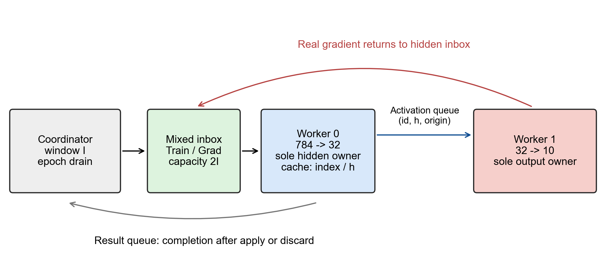

# Delayed gradients in CPU-based neural network training

An Operating Systems course project by **Kaustubh Upadhya, Dhruv Pekhale, Jeet Mahajan, and Tejas Tandon**, Indian Institute of Information Technology, Sri City.

**Research question:** How much synchronization waiting can CPU workers remove while keeping neural-network training useful?

This repository contains a C++17 reference implementation and an IEEE report studying a two-worker, bounded delayed-gradient runtime. A delayed gradient is a real backpropagated derivative computed from earlier hidden-layer state. Its age is the number of accepted hidden updates since its forward pass, not elapsed time.

The original team's source code was unavailable. The code here is a documented reconstruction from the supplied architecture guides, with its own verification and independent measurements. Original and fresh results remain separate.

## What the experiments show

| Evidence | Sequential mean | Delay 4 mean | Interpretation |
|---|---:|---:|---|
| Supplied five-epoch CSVs | 28.279 s, 91.4% final accuracy | 20.521 s, 91.6% final accuracy | Observed 1.38x ratio of mean times; original build/hardware unknown |
| Fresh reference, three runs each | 0.758 s, 91.8% | 0.819 s, 90.8% | Delay 4 does not beat optimized sequential on average |

Fresh synchronous workers average 2.558 s. Delay 4 is faster than that worker handshake, with a descriptive 3.125x ratio (the unrounded ratio is 3.124716). Fresh delays 0, 1, and 2 fail to reach 90% in all three five-epoch runs. Delay 4, 8, and 16 reach the target, but sequential reaches it sooner on average.

These are workload-specific observations. Rejecting gradients also skips hidden update computation. Completed examples/second must be read with acceptance, test quality, and time to target. No universally optimal delay or general CPU speedup is established.



## Architecture

- Worker 0 owns the 784-to-32 ReLU layer, its version counter, and pending forward-state cache.
- Worker 1 owns the 32-to-10 output layer and always applies one output update per example.
- A coordinator admits at most `I` unfinished examples and drains each epoch before evaluation.
- Three bounded mutex/condition-variable queues carry mixed hidden work, activations, and results. Returned gradients enter the hidden inbox.
- Worker 0 applies a gradient when `current_version - origin_version <= tau`; otherwise it discards that hidden gradient and releases the example's completion credit.
- Queue capacity is `2 * I` in this reconstruction. The original capacity is unknown.

One message represents one example, despite the term "batch" in older notes. Inputs remain immutable, and the hidden owner caches the original activation/ReLU mask. The output derivative uses output weights before their update. There are no synthetic gradients, local objectives, gradient shrinking, weight prediction, or GPU dependencies.

## Build and test

Requirements: a C++17 compiler with thread support; Python 3.10+ for scripts. Tested locally with Windows 11, MSYS2 MinGW GCC 15.2.0, and Python 3.14. Linux GCC is supported by the portable source and CI workflow. On Windows, keep your compiler's runtime DLL directory on `PATH` when executing the locally built binary.

From the repository root, using MSYS2 or a POSIX shell:

```bash
mkdir -p build
g++ -O2 -std=c++17 -pthread -Wall -Wextra -Wpedantic src/main.cpp -o build/mlp
./build/mlp --self-test
python -m unittest discover -s tests
```

On Windows PowerShell:

```powershell
New-Item -ItemType Directory -Force build | Out-Null
g++ -O2 -std=c++17 -pthread -Wall -Wextra -Wpedantic src/main.cpp -o build/mlp.exe
./build/mlp.exe --self-test
python -m unittest discover -s tests
```

Alternatively, build a release configuration with CMake:

```bash
cmake -S . -B build -DCMAKE_BUILD_TYPE=Release
cmake --build build --config Release
ctest --test-dir build -C Release --output-on-failure
```

For a multi-configuration generator, set `MLP_EXE` to `build/Release/mlp.exe` when running the Python tests or pass `--exe` to the sweep script. The mathematical checks compare finite-difference derivatives; integration tests verify queue shutdown, strict sequential/synchronous equivalence, age bounds, and count conservation on a generated IDX fixture.

## Dataset and individual runs

Download MNIST locally; the script verifies the published compressed-file MD5 checksums and prints SHA-256 hashes of the unpacked IDX files. Dataset files are ignored by Git.

```bash
python scripts/download_mnist.py
./build/mlp --mode sequential --epochs 5 --data data/mnist
./build/mlp --mode workers --tau 0 --in-flight 1 --epochs 5 --data data/mnist
./build/mlp --mode workers --tau 4 --in-flight 8 --epochs 5 --data data/mnist
```

Use `mlp.exe` on Windows. Defaults are 5,000 first training records, 1,000 first official test records, learning rate 0.01, seed 12345, and five epochs. Training indices shuffle each epoch. A run prints checkpoint CSV to stdout and initialization/worker/queue diagnostics to stderr. Redirect them separately:

```bash
./build/mlp --mode workers --tau 4 --in-flight 8 > run.csv 2> run.txt
```

`--help` lists all flags. Sequential mode ignores delay/window for execution. Synchronous means **tau=0 and in-flight=1**; tau=0 with eight in flight is a different asynchronous rejection policy.

## Reproduce the sweep and plots

```bash
python -m pip install -r requirements.txt
python scripts/audit_supplied.py
python scripts/run_experiments.py --output results/reproduction --repeats 3 --epochs 5
python scripts/plot_results.py
python scripts/audit_claims.py
python scripts/verify_submission.py
```

The harness randomizes configuration order within each repetition and runs configurations serially. It refuses to overwrite nonempty result folders. `plot_results.py` regenerates the committed submission figures from `results/supplied` and `results/fresh`; analyze later runs separately or deliberately update the selected input paths. Vector PDF/SVG and 300 dpi PNG outputs are included. Bands and whiskers are observed ranges, not confidence intervals.

## Report and files

- [IEEE report PDF](report/main.pdf): 14 pages including figures and references; 13 primary references
- [Report source](report/main.tex) and [BibTeX bibliography](report/references.bib)
- [Reproducibility notes](docs/reproducibility.md), [evidence and claim mapping](docs/evidence.md), [demo guide](docs/demo.md)
- `results/supplied/`: original CSVs, XLSX, timing log, and demo notes, unchanged
- `results/derived/`: audit, corrected timing labels, extracted instrumented observations, descriptive summaries
- `results/fresh/`: 24 raw CSV/text pairs, combined 120-epoch data, comparison, and environment/hashes
- `figures/`: plots and conceptual diagrams, including vector exports
- `docs/supplied/`: original project guides and architecture presentation for context

Compile the report in `report/` with a TeX distribution containing IEEEtran:

```bash
latexmk -pdf main.tex
# Or, using Tectonic:
tectonic main.tex
```

The compiled submission uses the standard IEEEtran conference class. Tables are generated from measured data by the plotting script.

## Limitations

The original source and environment are missing, and its timing headings are swapped. A corrected derived log uses numeric configuration fields; the raw evidence remains intact. Fresh measurements use one laptop, no pinned affinity, uncontrolled background load, one initialization seed, and only three scheduling repetitions. Time to 90% is observed at drained epoch checkpoints and excludes evaluation time. Fresh queue timers stop after mutex acquisition/predicate waiting, before deque mutation; pop counters can include evaluation/startup/drain gaps and are not CPU utilization. Exact original timer boundaries remain unverified. Maximum queue depth is not a time-weighted distribution. Memory payload sizes in the paper are calculated, not resident-memory measurements. This is a small systems prototype, not a state-of-the-art MNIST classifier.

The preserved guides and presentation are historical material. Their claims about an earlier project folder or implementation are not proof that those files were supplied here. Use the report and [second-pass claim audit](docs/claim_audit.md) for the corrected submission claims.

For eight in-flight examples, the single-output FIFO protocol bounds observed age by seven. Delay 8 and 16 therefore have equivalent acceptance policies here; differences between runs reflect scheduling rather than a meaningful acceptance-bound change.

## License

The MIT license applies to newly created source code, scripts, tests, and build files. Supplied artifacts and the authored report are excluded from that license; their authors retain their rights. External academic sources are cited, not redistributed as repository-owned work.
